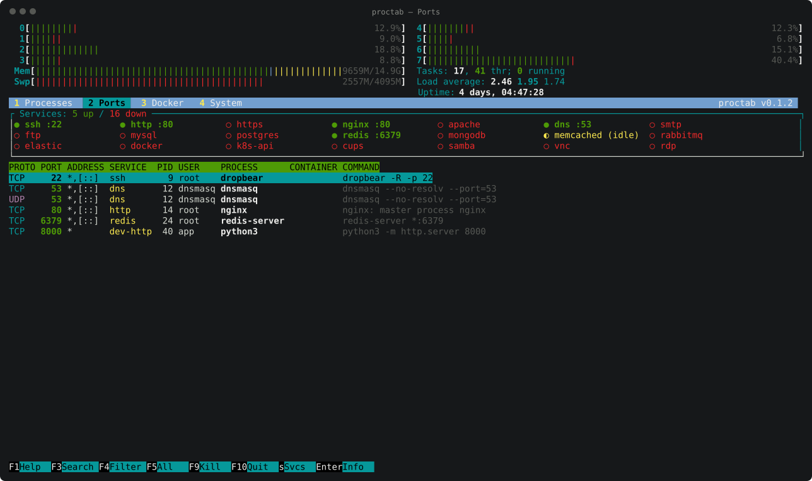
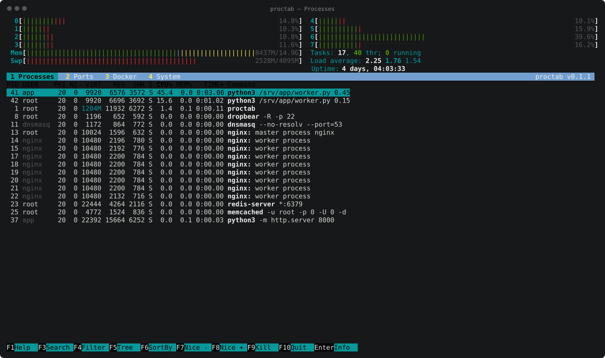
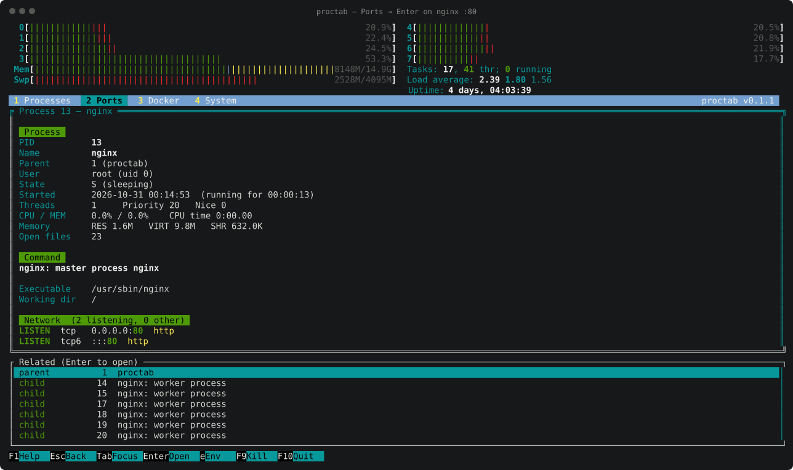
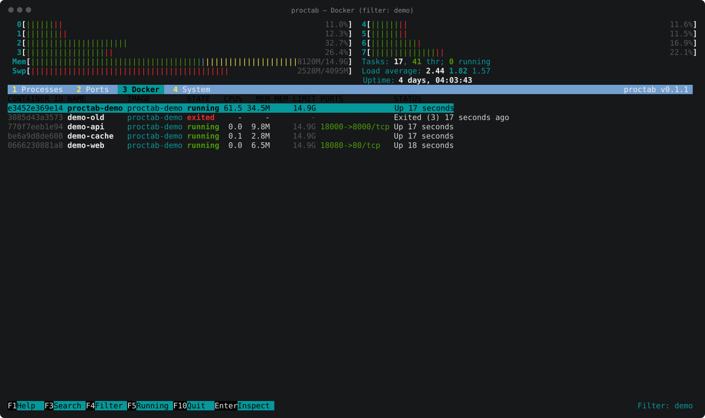
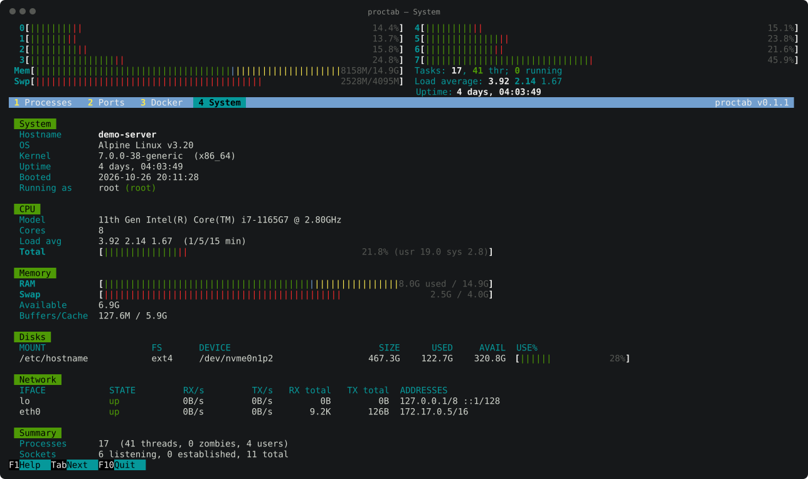

# proctab

**An htop-style terminal monitor that also shows your ports, Docker
containers and system info.** One static Linux binary, no runtime
dependencies.



## Inspired by htop

proctab looks like [htop](https://htop.dev) on purpose. We took htop's look
and its keys, and extended them with ports and Docker:
- the header with per-core CPU meters, Mem and Swp bars, tasks, load and
  uptime
- the green/red/blue meter colours
- the black-on-green column header and the cyan selection bar
- the F1–F10 key bar and its key bindings (`F3` search, `F4` filter, `F5`
  tree, `F6` sort, `F9` kill, `F10` quit, `/`, `\`, `t`, `P`, `M`, `T`, `k`, …)

If you know htop, you already know how to use proctab. Here is what it adds:

| | htop | proctab |
|---|---|---|
| Processes, tree, sort, search, filter, kill, renice | ✔ | ✔ |
| Listening ports with the owning PID, user and command | via external `lsof` | ✔ built in |
| Status of well-known services (ssh, nginx, mysql, postgres, redis, …) | – | ✔ green / yellow / red |
| Docker containers: state, CPU, memory, ports, inspect, processes | – | ✔ |
| System page: OS, disks, network rates, summary | – | ✔ |
| One drill-down view for ports, processes and containers, with history | – | ✔ |

proctab is an independent project, written from scratch in Go. It contains
no htop code and isn't affiliated with the htop project. See
[Credits](#credits-and-references).

## A quick tour

| | |
|---|---|
|  **Processes:** the htop list: columns, colours, tree view (`F5`), sorting, kill. |  **Enter on a port:** PID, parent, user, start time, full command, executable, working directory, sockets, children. |
|  **Docker:** every container with state, CPU%, memory and published ports. |  **System:** OS, kernel, CPU, memory, disks, network interfaces. |

**[Read the manual](docs/MANUAL.md)** for how to read every screen, column
and colour, plus all keys and permissions.

## Features

- **Processes:**
  - htop columns (PID USER PRI NI VIRT RES SHR S CPU% MEM% TIME+ Command)
  - tree view, sort, search, filter
  - kill with a chosen signal, renice
- **Ports:**
  - status grid of well-known services: green = listening, yellow = running
    without a port, red = down
  - every listening TCP/UDP socket with its owning PID, process, container
    and command
  - `a` shows all sockets, including established connections
- **Docker:**
  - every container with state, CPU%, memory and ports
  - Enter shows the inspect data (command, entrypoint, workdir, mounts,
    networks, ports, env) and the container's processes, opened by host PID
- **System:**
  - OS, kernel, uptime, CPU, load
  - memory and swap meters
  - disks with usage bars
  - network interfaces with RX/TX rates
- **Drill-down everywhere:**
  - Enter on any port, process or container opens one detail view
  - Related items (parent, children, container, the container's processes)
    open in turn
  - Esc walks back
- **Lightweight:**
  - reads `/proc` directly and talks to the Docker socket directly; no
    gopsutil, no Docker SDK
  - about 3% of one core and 17 MB of memory with 400 processes
- **Mouse:** click tabs, F-keys, column headers and services; double-click
  opens.

## Install

Every tagged release on GitHub has static binaries for linux amd64, arm64,
armv7, 386, riscv64, ppc64le, s390x and loong64, plus packages.

**apt (Debian / Ubuntu):**

```sh
sudo mkdir -p /etc/apt/keyrings
sudo curl -fsSL https://human-stuff.github.io/proctab/proctab.asc -o /etc/apt/keyrings/proctab.asc
echo "deb [signed-by=/etc/apt/keyrings/proctab.asc] https://human-stuff.github.io/proctab/apt stable main" \
  | sudo tee /etc/apt/sources.list.d/proctab.list
sudo apt update && sudo apt install proctab
```

`apt upgrade` then picks up new releases.

**pip / pipx** (the wheel contains the static binary, no Python code runs):

```sh
pipx install proctab --index-url https://human-stuff.github.io/proctab/simple/
# or
pip install proctab --index-url https://human-stuff.github.io/proctab/simple/
```

**Other options:**

```sh
# Debian / Ubuntu, single file
sudo apt install ./proctab_<version>_amd64.deb
# Fedora / RHEL / openSUSE
sudo rpm -i proctab-<version>.x86_64.rpm
# Alpine
sudo apk add --allow-untrusted proctab_<version>_x86_64.apk
# Arch
sudo pacman -U proctab-<version>-1-x86_64.pkg.tar.zst
# Any distro: plain binary
tar xzf proctab_<version>_linux_amd64.tar.gz && sudo install proctab /usr/local/bin/

# With Go
go install github.com/human-stuff/proctab/cmd/proctab@latest
# installs to ~/go/bin; add it to PATH if needed:
#   echo 'export PATH="$PATH:$HOME/go/bin"' >> ~/.bashrc && source ~/.bashrc

# From source
make build && sudo make install
```

As a container, it needs the host's PID and network namespaces:

```sh
docker run --rm -it --pid=host --net=host --cap-add SYS_PTRACE \
  -v /var/run/docker.sock:/var/run/docker.sock -v /etc/passwd:/etc/passwd:ro \
  ghcr.io/human-stuff/proctab
```

Linux only for now; it needs `/proc`.

## Usage

```
proctab [-d seconds] [-t processes|ports|docker|system] [-v]
```

Run with `sudo` to see the owners of every socket and the cwd, exe and
environment of other users' processes. Without root, these show as `-` and the
footer tells you how many sockets are hidden.

Docker access needs membership of the `docker` group, or root. Rootless Docker
(`$XDG_RUNTIME_DIR/docker.sock`) and `DOCKER_HOST=unix://...` are supported.

## Keys

The essentials. The [manual](docs/MANUAL.md#keys) has the full list.

| Key | Action |
|-----|--------|
| `1` `2` `3` `4` | Processes, Ports, Docker, System |
| `Enter` / `Esc` | open the detail view / go back |
| `F3` `/` · `F4` `\` | search · filter |
| `F5` | tree view (Processes), all sockets (Ports), running only (Docker) |
| `F9` `k` | send a signal |
| `F1` `?` | help |
| `F10` `q` | quit |

## Layout

```
cmd/proctab/         entry point and flags
internal/proc/       /proc process scanner, CPU%, tree, socket inode cache
internal/netstat/    /proc/net parser, well-known services list
internal/sysinfo/    CPU, memory, load, disks, network
internal/docker/     minimal Docker Engine API client (unix socket)
internal/ui/         tview UI: header, tabs, views, detail stack
docs/MANUAL.md       user manual (how to read every screen)
docs/DESIGN.md       research and design decisions
docs/screenshots/    screenshots, regenerated by scripts/screenshots/capture.sh
```

## Development and release

```sh
make build     # ./bin/proctab
make test      # unit tests
make vet       # gofmt + go vet
make snapshot  # local dry run of the release (needs goreleaser)
make docker    # local container image
scripts/screenshots/capture.sh   # regenerate docs/screenshots (needs docker + tmux)
```

GitHub Actions (`.github/workflows/`):

| Workflow | Trigger | What it does |
|----------|---------|--------------|
| `ci.yml` | push to `main`, pull requests | gofmt check, `go vet`, `go test -race`; cross-builds all 8 architectures; `goreleaser check` plus a snapshot build (packages uploaded as artifacts); multi-arch Docker build |
| `release.yml` | tag `v*` | tests, then GoReleaser publishes the GitHub Release (tar.gz, .deb, .rpm, .apk, Arch package, checksums, changelog); pushes a multi-arch image to `ghcr.io/human-stuff/proctab`; rebuilds the GitHub Pages site with the signed APT repo and pip index; optionally publishes to PyPI |

One-time setup before the first release (repo admin, needs `gh`):

```sh
./packaging/setup-signing-key.sh   # APT signing key -> APT_GPG_PRIVATE_KEY secret, enables Pages
```

For `pip install proctab` straight from PyPI:
1. Add a trusted publisher on pypi.org (workflow `release.yml`, environment `pypi`).
2. Set the repository variable `PUBLISH_PYPI=true`.

Dependabot keeps Go modules and the actions up to date.

To publish a release:

```sh
git tag v0.1.0
git push origin v0.1.0
```

Tags with a suffix (for example `v0.2.0-rc1`) are published as pre-releases
and don't move the `latest` image tag.

## Credits and references

proctab stands on the shoulders of these projects and documents:

- **htop**, the interactive process viewer, by Hisham Muhammad and the
  htop-dev team. proctab's layout, colours and key bindings follow htop's.
  <https://htop.dev> · <https://github.com/htop-dev/htop> (GPL-2.0; no htop
  code is used in proctab)
- **tview**, the terminal UI widget library, by Oliver Kuederle.
  <https://github.com/rivo/tview> (MIT)
- **tcell**, the terminal cell library, by Garrett D'Amore.
  <https://github.com/gdamore/tcell> (Apache-2.0)
- **proc(5)**, the Linux `/proc` filesystem manual: process, socket and
  system data. <https://man7.org/linux/man-pages/man5/proc.5.html>
- **Docker Engine API** reference: container list, inspect, top and stats
  endpoints. <https://docs.docker.com/reference/api/engine/>
- **ss(8) / lsof(8)**: the socket-to-process mapping proctab reproduces.
  <https://man7.org/linux/man-pages/man8/ss.8.html>
- **ctop** and **lazydocker** inspired the container view.
  <https://github.com/bcicen/ctop> ·
  <https://github.com/jesseduffield/lazydocker>
- **GoReleaser** and **nFPM** build the release archives and packages.
  <https://goreleaser.com> · <https://nfpm.goreleaser.com>

Research notes and design decisions: [docs/DESIGN.md](docs/DESIGN.md).
Other names considered: [NAMES.md](NAMES.md).

## License

MIT. See [LICENSE](LICENSE).
