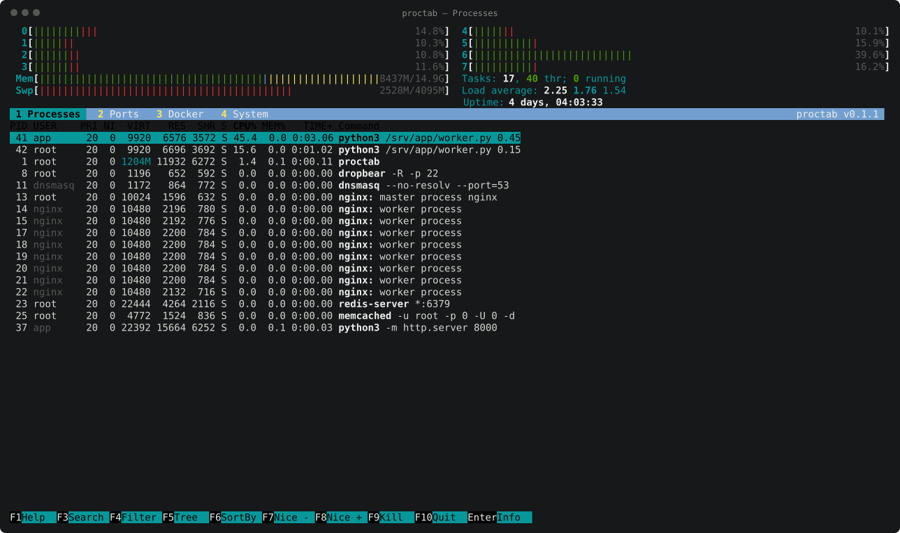
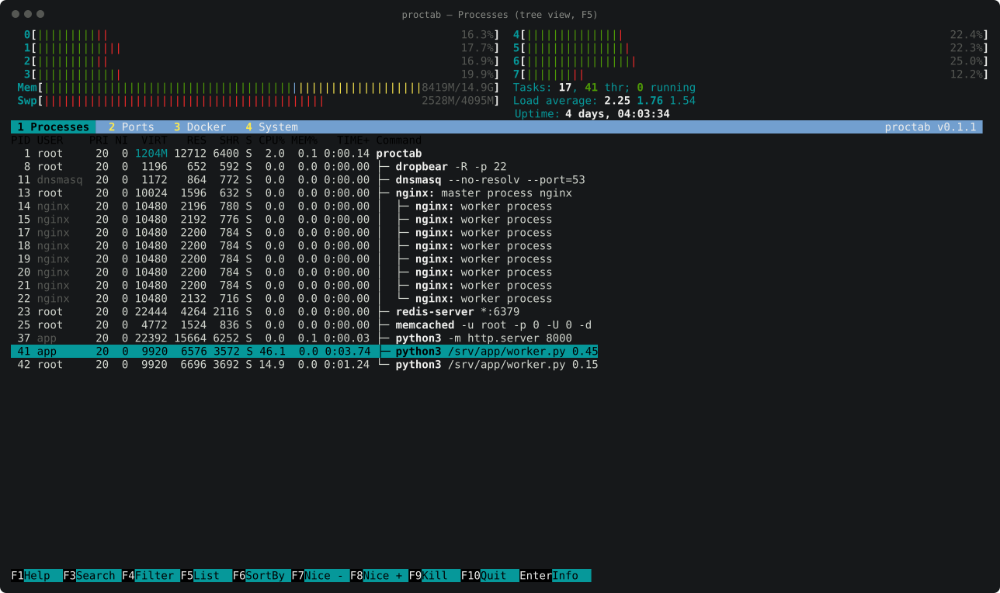
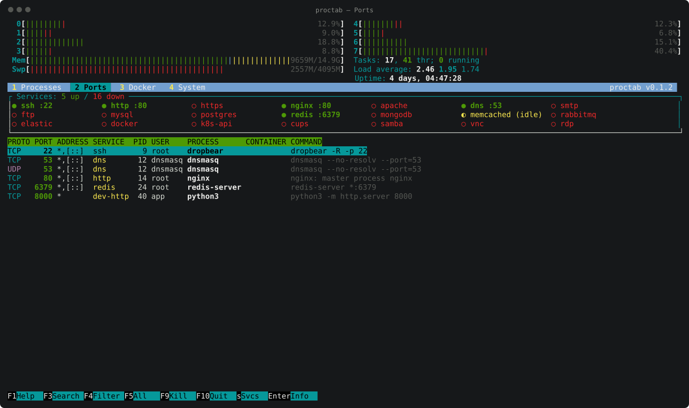
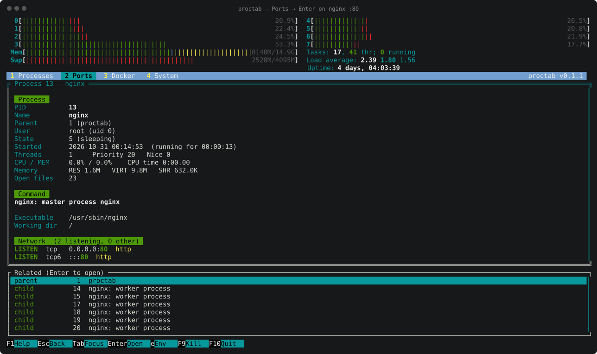
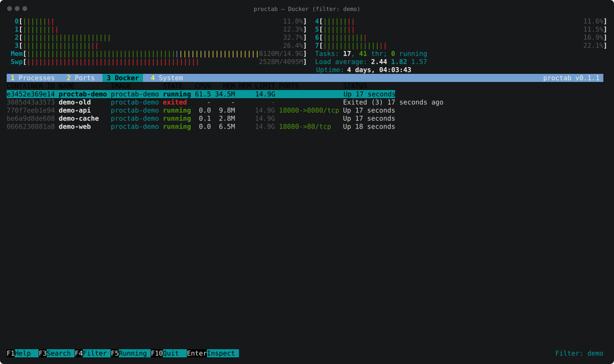
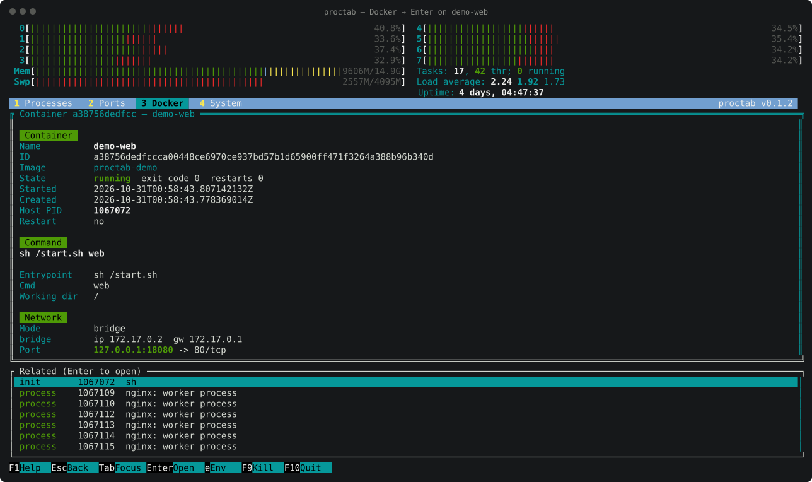
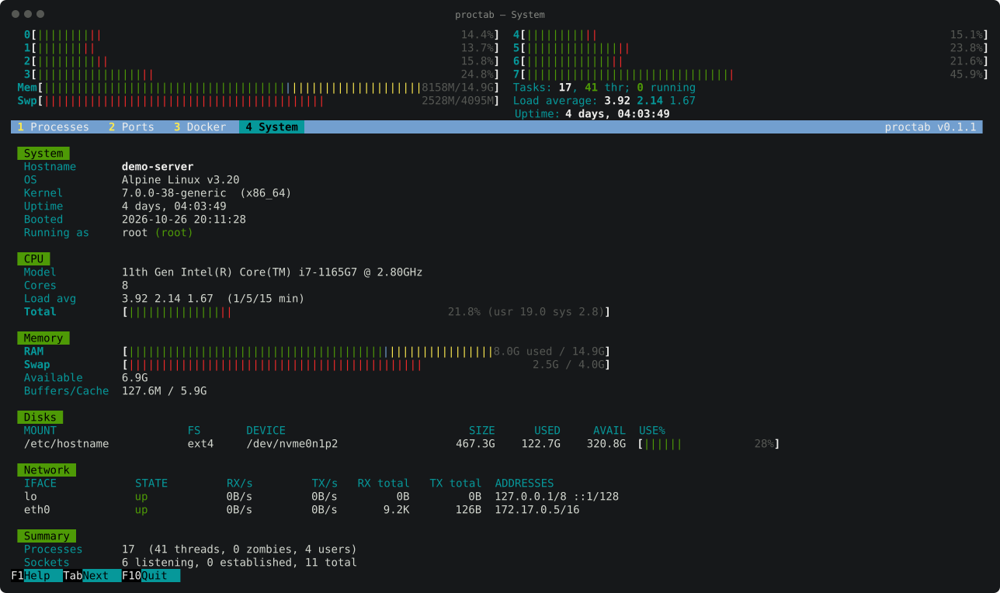
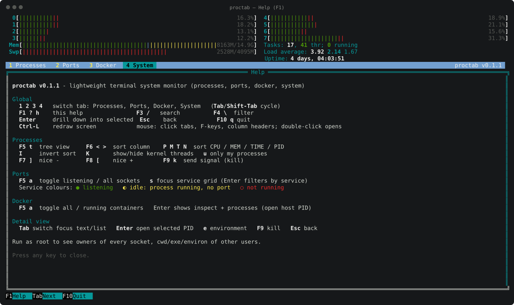

# proctab manual

This manual explains every screen of proctab and how to read it. The
screenshots come from a small demo machine running nginx, redis, an SSH
server, dnsmasq and a few Docker containers. `scripts/screenshots/capture.sh`
regenerates them. PNG copies of every screenshot (2576×1528) are in
[`docs/png/`](png/), for slides, blog posts and social media.

- [The screen layout](#the-screen-layout)
- [Header meters](#header-meters)
- [1 Processes](#1--processes)
- [2 Ports](#2--ports)
- [3 Docker](#3--docker)
- [4 System](#4--system)
- [The detail view](#the-detail-view)
- [Search and filter](#search-and-filter)
- [Keys](#keys)
- [Permissions: what you see as root and as a normal user](#permissions-what-you-see-as-root-and-as-a-normal-user)
- [Command-line options](#command-line-options)

---

## The screen layout

Every tab uses the same frame, borrowed from htop:

```
┌──────────────────────────────────────────────┐
│ header meters: CPU cores, Mem, Swp, Tasks…   │  always visible
├──────────────────────────────────────────────┤
│ 1 Processes  2 Ports  3 Docker  4 System     │  tab bar (click or press 1-4)
├──────────────────────────────────────────────┤
│                                              │
│   content of the current tab                 │
│                                              │
├──────────────────────────────────────────────┤
│ F1Help F3Search F4Filter F5… F10Quit         │  function-key bar (clickable)
└──────────────────────────────────────────────┘
```

The F-key bar changes with the tab. It always shows the keys that work right
now. The right end of the bar is used for messages, such as the active
filter, the result of a kill, or how many sockets have a hidden owner.

## Header meters

The top of the screen works like htop's.

```
  0[|||||||||                    12.9%]  4[||||||||              11.5%]
  …
 Mem[||||||||||||||||||||||  8480M/14.9G]  Tasks: 17, 40 thr; 0 running
 Swp[||||||||||||||||        2517M/4095M]  Load average: 3.30 1.85 1.42
                                           Uptime: 4 days, 03:55:39
```

| Meter | How to read it |
|-------|----------------|
| `0` … `N` | One bar per CPU core. **Green** is user time, **red** is kernel (system) time, **blue** is low-priority (niced) time. The number is the core's total busy %. |
| `Mem` | **Green** is used memory (total − available), **blue** is buffers, **yellow** is page cache. The text is used/total. |
| `Swp` | Swap in use, shown in red. |
| `Tasks` | Processes, total threads, and how many are running right now. |
| `Load average` | 1, 5 and 15 minute load averages. A load higher than your core count means work is queuing. |
| `Uptime` | Time since boot. |

Values update every refresh (1.5 s by default; change it with `-d`).

## 1 · Processes



This is the htop process list. Each row is one process. By default the list
is sorted by CPU% with the busiest at the top, and the highlighted (cyan)
column header shows the sort column.

| Column | Meaning |
|--------|---------|
| `PID` | Process ID. |
| `USER` | Owner. Other users' processes are dimmed. |
| `PRI` / `NI` | Kernel priority and nice value. Negative nice (higher priority) is red; positive nice is blue. `RT` means real-time. |
| `VIRT` | Virtual memory size. |
| `RES` | Resident memory: what the process really uses in RAM. Values in **M** are cyan and values in **G** are green, so big processes stand out. |
| `SHR` | Shared memory (libraries, shared mappings). |
| `S` | State: **R** running (green), **S** sleeping, **D** uninterruptible I/O wait (red: often a stuck disk or NFS), **Z** zombie / **T** stopped (yellow), **I** idle kernel thread. |
| `CPU%` | Share of **one** core since the last refresh. 100% is one full core; a multithreaded program can exceed 100%. Yellow from 50%, red from 90%. |
| `MEM%` | RES as a percentage of total RAM. |
| `TIME+` | Total CPU time used (minutes:seconds.hundredths, or `XhMM:SS`). |
| `Command` | The full command line. The program's directory is cyan and its name is bold white. Kernel threads show as `[name]` in gray and are hidden by default (`K` shows them). |

The cursor stays on the **same process** while the list re-sorts, as in
htop, so a process won't slip away while you read it.

### Tree view (F5)



`F5` or `t` switches to a parent/child tree. Branches are drawn with
`├─`, `│` and `└─`. In the example, `nginx: master process` owns eight
`worker process` children.

### Acting on a process

- `F9` or `k` opens the signal dialog: TERM (polite stop), KILL (force),
  HUP (reload config for most daemons), INT, STOP and CONT.
- `F7` / `]` lowers the nice value (higher priority, needs root). `F8` / `[`
  raises it.
- `Enter` opens the [detail view](#the-detail-view).

## 2 · Ports



The Ports tab answers two questions: *which well-known services are up?* and
*who is listening on which port?*

### Services grid (top box)

| Symbol | Colour | Meaning |
|--------|--------|---------|
| `● name :ports` | green | Something is listening on the service's port, or a process with the service's name holds a listening socket. The ports it uses are listed. |
| `◐ name (idle)` | yellow | The service's process is running but holds no listening port. For example, memcached started with networking disabled, or a daemon that is still starting. |
| `○ name` | red | Not running. |

The box title counts them (`Services: 5 up / 16 down`). Click a service, or
press `s` and use the arrows and Enter, to show only that service's sockets
in the table. Click it again or press Esc to clear.

The list of services is in
[`internal/netstat/services.go`](../internal/netstat/services.go). To add
your own, add one line with the name, its ports and its process names.

### Socket table

One row per listening socket. IPv4 and IPv6 sockets of the same process and
port are merged into one row.

| Column | Meaning |
|--------|---------|
| `PROTO` | `TCP` (cyan) or `UDP` (magenta). For UDP, "listening" means bound and not connected. |
| `PORT` | Local port (green). |
| `ADDRESS` | Where it listens. `*` is every IPv4 address, `[::]` every IPv6 address, and `127.0.0.1` / `::1` means local only, not reachable from the network. |
| `SERVICE` | Well-known name for the port (yellow), e.g. `ssh`, `http`, `dns`, `redis`. |
| `PID` | Owning process. A red `-` means proctab could not see the owner (see [Permissions](#permissions-what-you-see-as-root-and-as-a-normal-user)). |
| `USER` | Owner of the socket. |
| `PROCESS` | Program name. |
| `CONTAINER` | Docker container the socket belongs to, if any. Published ports held by `docker-proxy` are matched to their container too. |
| `COMMAND` | Full command line (gray). |

`F5` or `a` switches to **all sockets**, which adds established connections
and their states. `ESTABLISHED` is cyan, `LISTEN` green, and the closing
states (`TIME_WAIT`, `CLOSE_WAIT`, …) yellow. Many `CLOSE_WAIT` sockets
usually point to a program that doesn't close its connections.

### Drilling into a port



Press `Enter` on a row (or double-click it) to open the process behind the
port. Here port 80 leads to `nginx: master process`. The screen shows:

- who started it (`Parent`), as which user, when, and for how long it has run
- the exact command, the executable on disk and its working directory
- every socket it holds: here `LISTEN tcp 0.0.0.0:80` and `tcp6 :::80`
- in the **Related** box, its parent and its eight worker children. Press
  `Tab` to move into the box and `Enter` to open one.

See [the detail view](#the-detail-view) for every field.

## 3 · Docker



One row per container: running and stopped.

| Column | Meaning |
|--------|---------|
| `CONTAINER ID` | Short ID. |
| `NAME` | Container name. |
| `IMAGE` | Image it runs. |
| `STATE` | **running** (green), **exited** / **dead** (red), **paused** / **restarting** / **created** (yellow). |
| `CPU%` | CPU use, where 100% is one core. `…` means still measuring (Docker needs ~2 s for the first sample). |
| `MEM` / `MEM LIMIT` | Memory in use (page cache excluded, like `docker stats`) and the container's limit. Without a limit, the limit is the host's RAM. |
| `PORTS` | Published ports as `host->container/proto`. |
| `STATUS` | Docker's status text, e.g. `Up 17 seconds`, `Exited (3) 17 seconds ago`. |

`F5` or `a` toggles between all containers and only running ones. In the
screenshot, the filter `demo` (F4) is active; the footer shows it.

### Container detail



`Enter` on a container shows:
- its full ID, image, state, exit code and restart count
- `Host PID`: the container's main process as seen from the host
- the command, entrypoint, working directory and user
- its network mode, IP addresses and published ports
- mounts, and the container's environment variables (`e`)
- its processes, listed by host PID

The **Related** box links to the container's `init` process and to every
process inside it. Opening one shows the normal process detail view, so you
can go from a container to its process, the process's sockets, its parent,
and back again with `Esc`.

## 4 · System



Everything about the machine on one page:

| Section | Contents |
|---------|----------|
| System | Hostname, OS, kernel and architecture, uptime, boot time, and the user proctab runs as (with a note if not root). |
| CPU | Model, number of cores, load averages, and a total CPU meter split into user and system time. |
| Memory | RAM and swap meters with the same colours as the header, available memory, buffers and cache. |
| Disks | Each real filesystem: mount point, type, device, size, used, available, and a usage bar that turns yellow above 75% and red above 90%. Pseudo filesystems (proc, tmpfs, overlay, snaps…) are left out. |
| Network | Each interface: up/down, current RX and TX rate, totals since boot, and its addresses. |
| Summary | Counts of processes, threads, zombies, users, listening and established sockets, and Docker containers. |

## The detail view

The same view opens from every tab. Its fields:

| Field | Meaning |
|-------|---------|
| PID, Name, Parent | The process, its program name, and its parent (PID and name). |
| User | Owner name and numeric uid. |
| State | State letter and its meaning (see the `S` column). |
| Started | Start date and time, and how long ago that was. |
| Threads, Priority, Nice | Scheduling information. |
| CPU / MEM | Current CPU% and MEM%, plus total CPU time. |
| Memory | RES, VIRT, SHR. |
| Open files | Number of open file descriptors. A number that keeps growing hints at a leak. |
| Command | The complete command line, never truncated. |
| Executable | The binary on disk (`/proc/PID/exe`). `(deleted)` means the binary was replaced, usually by an upgrade, and the process still runs the old version. |
| Working dir | The directory the process runs in (`/proc/PID/cwd`). |
| Container | If the process is inside a container: its name and ID, linked in Related. |
| Network | Every TCP/UDP socket of the process: listening sockets first, then connections with their remote address. |
| Cgroup | The control group, showing which systemd service, user session or container the process belongs to. |
| Environment | Number of variables. Press `e` to list them. |
| Not readable | Fields hidden by permissions, and why. |

The detail view keeps a **history stack**:
- `Enter` in the Related box opens that item.
- `Esc`, `Backspace` or `←` goes back one step.
- Esc on the first item returns to the tab.

## Search and filter

- **Search** (`F3` or `/`) jumps to the next row that contains the text. `n`
  repeats the search in the Processes tab.
- **Filter** (`F4` or `\`) hides every row that doesn't contain the text, and
  keeps hiding them as the list updates. The footer shows the active filter.
  Press `Enter` to keep the filter and return to the list, or `Esc` in the
  prompt to clear it.

Both are case-insensitive. They match on the command line, program name,
user and PID, and in the Ports and Docker tabs also on port, service, image
and container name.

## Keys

| Key | Where | Action |
|-----|-------|--------|
| `1` `2` `3` `4` | everywhere | Processes, Ports, Docker, System |
| `Tab` / `Shift-Tab` | tabs | next / previous tab |
| `F1` `?` `h` | everywhere | help (any key closes it) |
| `F3` `/` | lists | search |
| `F4` `\` | lists | filter |
| `Enter`, double-click | lists | open the detail view |
| `Esc` `Backspace` | detail | back |
| `F10` `q` `Ctrl-C` | everywhere | quit (`q` goes back inside the detail view) |
| `Ctrl-L` | everywhere | redraw the screen |
| `F5` `t` | Processes | tree view on/off |
| `F6` `>` `<` | Processes | next / previous sort column |
| `P` `M` `T` `N` | Processes | sort by CPU / memory / time / PID |
| `I` | Processes | invert sort order |
| `K` | Processes | show or hide kernel threads |
| `u` | Processes | only my processes |
| `F7` `]` / `F8` `[` | Processes | nice − / nice + |
| `F9` `k` | Processes, Ports, detail | send a signal |
| `F5` `a` | Ports | listening only / all sockets |
| `s` | Ports | move into the services grid |
| `F5` `a` | Docker | all / running containers |
| `Tab` | detail | switch between the text and the Related box |
| `e` | detail | show or hide environment variables |

With the mouse, you can click tabs, F-keys, column headers (to sort) and
services. Double-click opens an item, and the wheel scrolls.



## Permissions: what you see as root and as a normal user

Linux only lets a user look inside **their own** processes. As a normal user
proctab still shows every process, every socket and every container (if you
can use Docker), but for other users' processes these are hidden:

- which process owns a socket. `PID` shows a red `-`, and the footer says
  `N sockets with hidden owner (run with sudo)`
- the working directory, executable, environment and open files. The detail
  view lists them under **Not readable**

Run `sudo proctab` for the full picture.

Inside a container, root also needs `--cap-add SYS_PTRACE` to look inside
processes owned by other users:

```sh
docker run --rm -it --pid=host --net=host --cap-add SYS_PTRACE \
  -v /var/run/docker.sock:/var/run/docker.sock -v /etc/passwd:/etc/passwd:ro \
  ghcr.io/human-stuff/proctab
```

The Docker tab needs access to the Docker socket. You get it as root or as a
member of the `docker` group (`sudo usermod -aG docker $USER`, then log in
again). Rootless Docker and `DOCKER_HOST=unix://…` work too. Without access,
the tab shows the reason instead of a list.

## Command-line options

```
proctab [-d seconds] [-t tab] [-v]

  -d   refresh interval in seconds (default 1.5, minimum 0.2)
  -t   start tab: processes, ports, docker or system
  -v   print version and exit
```
